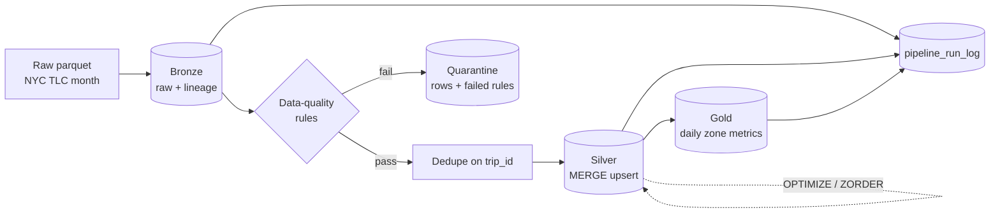

# Medallion Lakehouse on Databricks (PySpark + Delta Lake)

An incremental bronze → silver → gold pipeline for NYC yellow-taxi trip data.
It focuses on the things that matter in production: idempotent loads, data-quality
quarantine instead of silent drops, partition-pruned `MERGE`, and a run log with
measurable metrics.

## Architecture



| Layer | Table | What it holds |
|---|---|---|
| Bronze | `bronze_trips` | Raw columns as loaded, plus `_ingest_ts` and `_source_file`. Append-only. |
| Silver | `silver_trips` | Typed, validated, de-duplicated trips with a deterministic `trip_id`. Partitioned by `pickup_date`. |
| Quarantine | `silver_trips_quarantine` | Rows that broke a rule, with the names of the rules (`dq_failures`). |
| Gold | `gold_daily_zone_metrics` | Trips, revenue, average distance/fare/duration/tip per pickup date and zone. |
| Ops | `pipeline_run_log` | One row per run: rows read, quarantined, inserted, updated, duration. |

## Design decisions

- **Deterministic business key.** `trip_id` is a SHA-256 of the fields that identify a trip,
  so the same trip always gets the same id across runs.
- **Idempotent silver.** Silver is loaded with Delta `MERGE` on `trip_id`. Re-running a file
  updates rows in place and inserts nothing new.
- **Partition pruning in the merge.** The merge condition includes the batch's
  `pickup_date` range, so Delta only touches files for the dates in the batch.
- **Quarantine, not drop.** Bad rows are kept with the reasons, so data issues can be
  reported and fixed upstream.
- **Gold rebuilt per affected date.** Only dates touched by the batch are rewritten
  (`replaceWhere`), not the whole table.
- **Pure transforms.** All business logic lives in `transforms.py` / `quality.py` with no
  I/O, so it is unit-tested without a cluster. Delta operations are isolated in `io.py`.

### Data-quality rules

`null_pickup_ts`, `null_dropoff_ts`, `null_location`, `dropoff_before_pickup`,
`trip_too_long` (> 24h), `non_positive_distance`, `distance_outlier` (> 200 miles),
`negative_fare`, `negative_total`, `bad_passenger_count` (< 0 or > 8), and an optional
`pickup_outside_expected_range` for catching mis-dated rows in a monthly file.

## Run it on Databricks

1. Create a free [Databricks account](https://www.databricks.com/learn/free-edition).
2. Import this repo: **Workspace → Create → Git folder**, paste your repo URL.
3. Get data from the [NYC TLC trip record page](https://www.nyc.gov/site/tlc/about/tlc-trip-record-data.page)
   (Yellow Taxi, a monthly parquet file), or generate a synthetic file:
   `python scripts/generate_sample_data.py --rows 500000 --out sample_trips.parquet`.
4. Upload the file to a Unity Catalog volume (**Catalog → your schema → Create → Volume**).
5. Open `notebooks/01_run_pipeline.py`, set the `source_path` widget to the file path, and
   run all cells. Use one monthly file per run. Run the same file twice to see that the
   silver table does not change.

## Run the tests locally

The transform and data-quality logic is tested with a local Spark session (Java 17+ required).

```bash
pip install -r requirements.txt
pytest
```

Delta-specific steps (`MERGE`, `OPTIMIZE`, `replaceWhere`) are exercised by running the
notebook on Databricks.

## Results

Fill this in from your own runs. See [`docs/benchmarks.md`](docs/benchmarks.md).

## Project layout

```
src/lakehouse/   config, quality rules, transforms, Delta I/O, pipeline
notebooks/       Databricks notebook that runs the pipeline
scripts/         synthetic data generator
tests/           unit tests for transforms and data-quality rules
docs/            benchmark notes
```

## Notes and limitations

- Bronze and quarantine are append-only logs, so re-running a file adds its raw and
  rejected rows again. Silver and gold stay correct because of the `MERGE` and `replaceWhere`.
- One TLC month per run: parquet column types differ between months, so mixing months in a
  single read can fail schema merging.
- Z-ordering by `pu_location_id` is used for illustration. On newer runtimes, liquid
  clustering is the recommended alternative to partition + Z-order.
